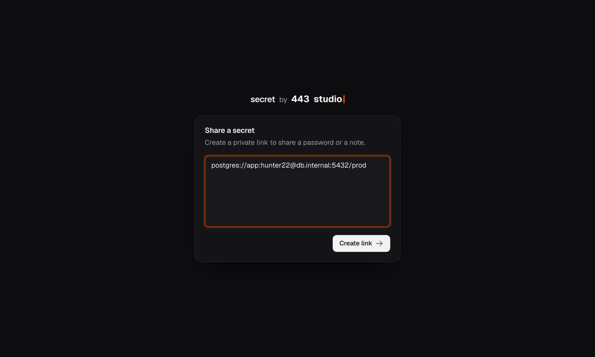

# secret.443.studio

Share a secret note with an encrypted link. The link expires after 5 days.



## Web

Write the note, click **Create link**, choose whether to add a 4-digit PIN. The browser encrypts the
note. The key is in the link after `#` and never reaches the server.

## API

`POST /` creates a secret. The response is only the URL.

```bash
curl --data-binary 'my secret' https://secret.443.studio

curl -H 'content-type: application/json' \
   -d '{"text":"my secret","pin":"1234"}' \
   https://secret.443.studio
```

`pin` is optional (4 digits). With the API, the server encrypts the note and does not keep the key.

## Run

```bash
pnpm install
pnpm dev
```

## Deploy (Dokploy)

Build with the `Dockerfile`. Mount a volume on `/data` (SQLite file). Set
`NUXT_PUBLIC_SITE_URL=https://secret.443.studio`. Run one replica only.
